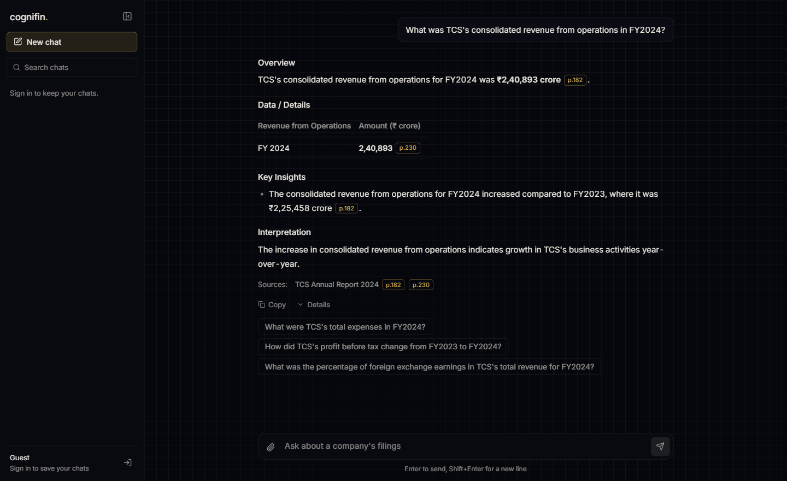
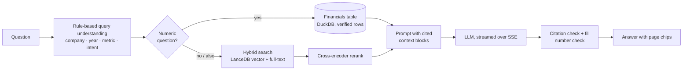

# Cognifin

**Ask questions about India's 100 largest listed companies. Every answer cites the page it came from.**

[](https://github.com/Kaivalya078/Cognifin/actions/workflows/ci.yml)
[](LICENSE)

**Live:** [cognifin-eight.vercel.app](https://cognifin-eight.vercel.app) · **Eval results:** [/engineering](https://cognifin-eight.vercel.app/engineering)



Cognifin is a retrieval-augmented QA app over the NIFTY 100: FY2025 and FY2026 annual reports plus seven quarters of results. Ask in plain English ("What was Hindustan Unilever's profit after tax in FY2025?"). The answer comes back streamed, with page chips that open the source PDF at the cited page. Headline figures come from a table of results checked against the filings, not from the model's memory.

## Results

Measured on a 119-question golden set across 64 companies (`backend/tests/golden_set.json`), with the production setup (ONNX int8 models, `gpt-4o-mini`):

| Metric | Score |
|---|---|
| Faithfulness (claims supported by retrieved context) | **1.00** |
| Correctness (judged against the answer key) | **0.91** |
| Citation validity (cited page actually holds the claim) | **1.00** |
| Answers with at least one citation | **1.00** |
| Refuses when the filings don't hold the answer | **1.00** |
| Retrieval hit@3 / hit@8 | 0.76 / 0.93 |
| Latency p50 / p95 (end to end, incl. LLM) | 4.7 s / 9.3 s |

Full history and method: [`backend/tests/eval_reports/README.md`](backend/tests/eval_reports/README.md). Verified financial figures: 100% precision on a 36-case answer key, enforced in CI.

## How it works



- **Query understanding** is deterministic: company aliases, fiscal-year and quarter parsing, intent (lookup, compare, trend…). Retrieval is scoped to the companies and years asked about.
- **Financials table.** Revenue, profit, EPS and bank/insurer ratios are extracted from NSE iXBRL filings and results PDFs (rules first, LLM fallback, OCR for scanned pages), cross-checked, and stored in DuckDB. Numeric questions get these rows as a verified context block, and a post-check flags any number in the answer that matches no row.
- **Retrieval.** `bge-base-en-v1.5` embeddings plus full-text search in LanceDB, fused with RRF, reranked by `ms-marco-MiniLM-L-6-v2`. Both models run as ONNX int8 without PyTorch, so the API fits in a 1 GB VM.
- **Generation.** The model must cite chunk ids. Citations are verified, filled only on exact figure matches, and mapped to PDF pages. If the filings don't hold the answer, it says so and offers to read an uploaded report.
- **Uploads.** Any PDF can be uploaded for the session and is searched alongside the corpus.

## Stack

| | |
|---|---|
| Backend | Python 3.13, FastAPI, LanceDB, DuckDB, ONNX Runtime, PyMuPDF, OpenAI API |
| Frontend | React + Vite, pdf.js, Recharts, GSAP |
| Data | MongoDB Atlas (users, chats), Hugging Face datasets (index, PDFs) |
| Hosting | Vercel (frontend), Azure VM + Docker + Caddy (API) |
| Quality | pytest (441 tests), ruff, ESLint, offline eval gates in GitHub Actions |

## Repository layout

```
backend/
  main.py           FastAPI app: /chat, /chat/stream, /upload, auth
  core/             chunking, LanceDB store, retrieval, reranker, ONNX models
  query/            query understanding, planning, context assembly
  financials/       iXBRL/PDF extraction, checks, DuckDB store, numeric router
  generation/       prompts, OpenAI client, streaming, citation fill
  ingestion/        corpus ingest, ONNX export, coverage check
  routers/          conversations, Google OAuth
  tests/            unit tests, golden sets, eval harnesses, eval_reports/
frontend/           React app: landing, chat, engineering, auth pages
docs/               deploy guide, design specs and implementation plans
docker-compose.yml  API + Caddy for the VM
```

## Run it locally

**Backend** (Python 3.13):

```bash
cd backend
python -m venv venv
venv\Scripts\activate              # macOS/Linux: source venv/bin/activate
pip install -r requirements.txt
cp .env.example .env               # set JWT_SECRET, OPENAI_API_KEY, MONGO_URI
uvicorn main:app --reload          # http://localhost:8000/docs
```

**Frontend** (Node 22):

```bash
cd frontend
npm install
npm run dev                        # http://localhost:5173, talks to localhost:8000
```

**Corpus.** PDFs are not in the repo. Put annual reports at `backend/data/<SYMBOL>/<YEAR>.pdf` and build the index and the financials table:

```bash
cd backend
python -m ingestion.batch_ingest_annual_reports    # -> index_cache/lancedb
python -m financials.build                         # -> index_cache/financials.duckdb
```

Embedding the full corpus takes hours on CPU and minutes on an NVIDIA GPU. For a local GPU, install the CUDA build of PyTorch into your venv only (`pip install --force-reinstall --no-deps torch --index-url https://download.pytorch.org/whl/cu128`). Changing the chunker, `EMBEDDING_MODEL` or `QUERY_INSTRUCTION` needs a full re-index.

Every setting lives in `backend/config.py` and is documented in `backend/.env.example`. The API refuses to start without a real `JWT_SECRET` and rejects unknown `.env` keys.

## Tests and evals

```bash
cd backend
python -m pytest tests/test_*.py -q            # unit tests
python -m tests.eval_financials                # financials precision/coverage (offline)
python tests/eval_router.py --strict           # numeric router (offline)
python -m tests.eval_answers --label NAME     # full answer eval (paid, ~$0.17 per run)
```

CI runs lint, unit tests and the two offline eval gates on every PR. The paid answer eval runs locally and publishes `frontend/public/metrics.json`, which feeds the `/engineering` page.

## Deploy

See [docs/deploy.md](docs/deploy.md): Hugging Face datasets for the index and PDFs, a 1 GB Azure VM with Docker and Caddy, MongoDB Atlas, Google sign-in and Vercel.

## License

[MIT](LICENSE). Annual reports and filings belong to their companies. Cognifin is not financial advice.
